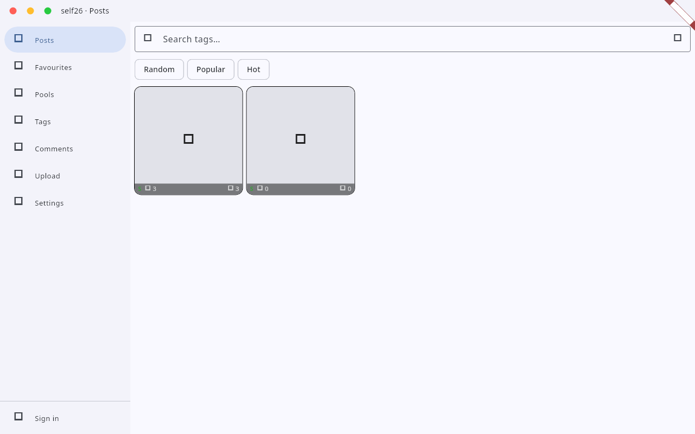
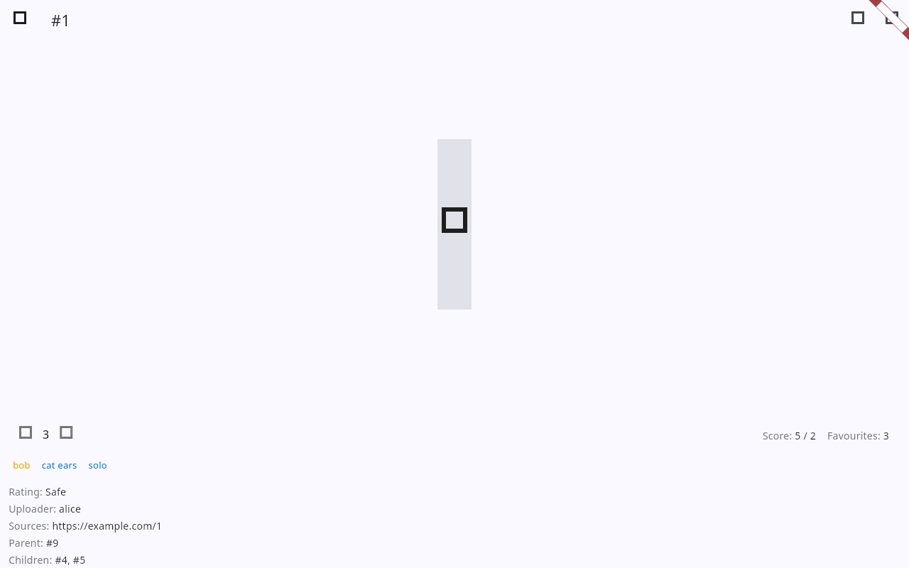
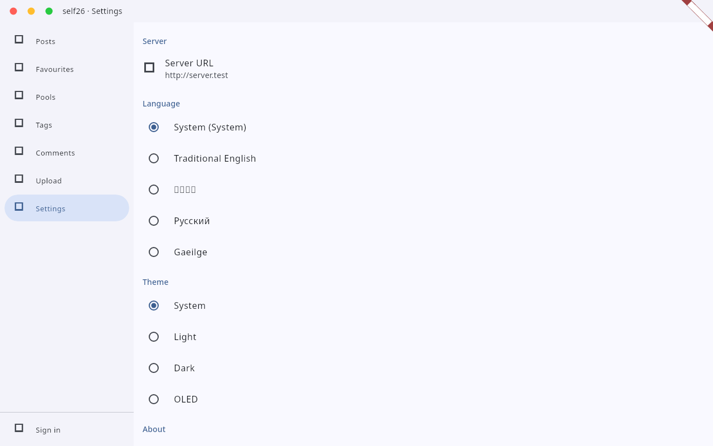

# self26

Your own e621-compatible media server. Host your collection, browse it from
anywhere, and talk to it with any e621 client.

**Landing page:** https://httpanimations.gitlab.io/self26/

self26 is a single Rust binary with an embedded web UI. Point it at a folder,
sign in, and you get a booru-style board with posts, tags, pools, comments,
votes and favourites. The API matches the current e621 v2 API, so existing
tools and scripts work against it.

## Get it

Grab a build from [GitLab Releases](https://gitlab.com/HttpAnimations/self26/-/releases).
Every release ships Windows installers and zips, Linux AppImage, deb, rpm and
archives, signed Flatpak repos, a macOS app, Android APK/AAB, an unsigned iOS
IPA, the web build and source archives.

### Linux Flatpak

    curl -fLO https://httpanimations.gitlab.io/self26/flatpak/key.gpg
    flatpak remote-add --if-not-exists --gpg-import=key.gpg self26 https://httpanimations.gitlab.io/self26/flatpak
    flatpak install self26 gitlab.httpanimations.self26

Or one line: `flatpak install https://httpanimations.gitlab.io/self26/self26.flatpakref`

### iOS via AltStore

Add this source in AltStore:

    https://gitlab.com/HttpAnimations/self26/-/raw/main/repos/altstore.json

### Docker

    docker run -p 8210:8210 -v self26-data:/data registry.gitlab.com/httpanimations/self26:latest

The web UI is served on the same port as the API.

## Screenshots

## Server

    self26 --data-dir /path/to/data --port 8210

Uploads, metadata and thumbnails live in the data dir. Use the API with an
e621 client by adding your server URL and API key.

## Licence

AGPL-3.0. See [LICENSE](LICENSE).
